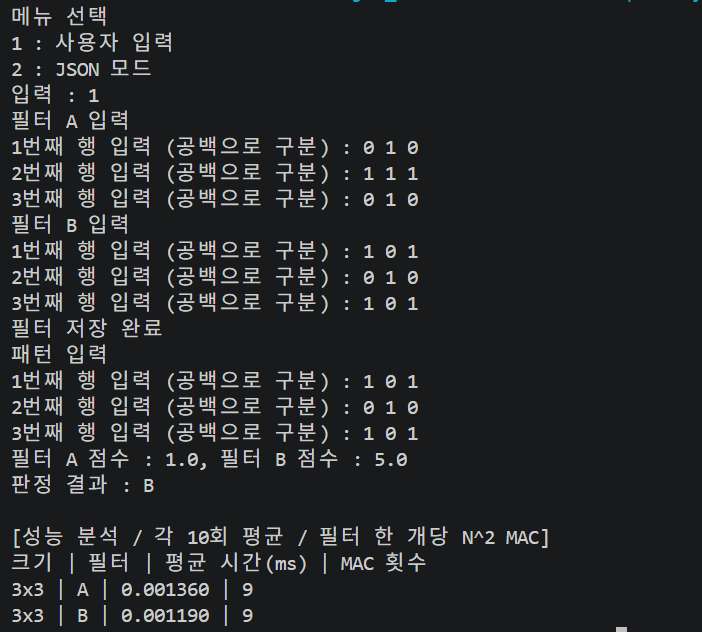
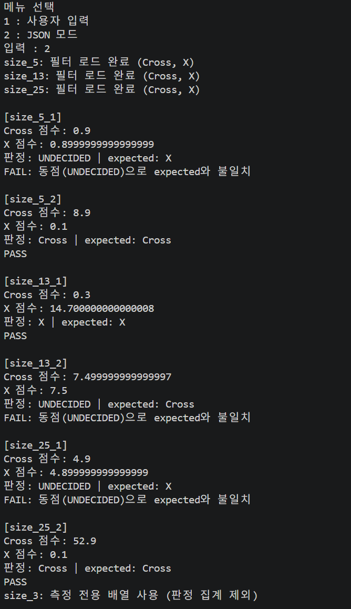
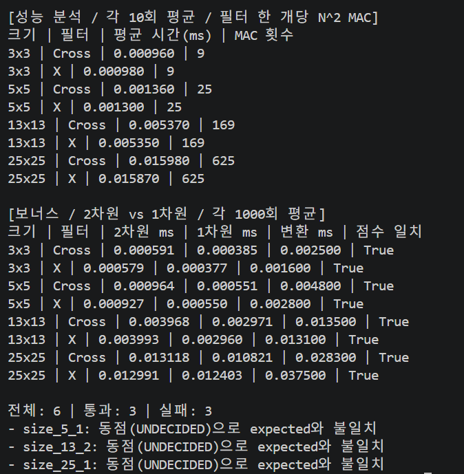

# E1-3 Mini NPU Simulator

입력 패턴과 두 필터의 같은 위치 값을 곱하고 더해 점수를 비교하는 Python 콘솔 프로그램입니다.
3×3 직접 입력과 JSON 일괄 분석을 지원하며, 배열을 1차원으로 펼쳤을 때의 계산 시간도 비교합니다.

## 실행 방법

Python 3.8 이상에서 실행합니다. 외부 라이브러리는 필요하지 않습니다.

```bash
python main.py
```

메뉴에서 `1`은 직접 입력, `2`는 JSON 분석입니다.
`data.json`은 `json_manual.py`와 같은 폴더에 둡니다. 파일 경로는 실행 위치가 아니라 해당 소스 파일 위치를 기준으로 찾습니다.

### 모드 1: 직접 입력

필터 A, 필터 B, 패턴 순서로 각각 3행을 입력합니다. 한 행은 공백으로 구분한 숫자 3개입니다.
잘못된 숫자나 열 개수가 들어오면 그 행만 다시 입력받습니다.

| 입력 대상 | 필터 A (+) | 필터 B (X) | 패턴 (X) |
|---|---|---|---|
| 1행 | `0 1 0` | `1 0 1` | `1 0 1` |
| 2행 | `1 1 1` | `0 1 0` | `0 1 0` |
| 3행 | `0 1 0` | `1 0 1` | `1 0 1` |

이 입력의 출력은 A 점수 1.0, B 점수 5.0, 판정 B입니다.
A와 B 각각에 대해 MAC을 10회 측정한 평균 시간과 연산 횟수 9(3²)를 표시합니다.
두 점수가 허용오차 안에서 같으면 `판정 불가`를 출력합니다.

### 모드 2: JSON 분석

메뉴에서 `2`를 선택하면 제공된 `data.json`을 읽습니다.
필터의 가중치와 패턴값은 수정하지 않습니다.
`size_13_2`에서 크기 13을 추출해 `size_13` 필터 두 개와 비교합니다.
케이스별 점수·판정·PASS/FAIL을 출력한 다음 성능 표, 보너스 비교 표, 전체 결과 요약을 표시합니다.

## 파일 구성

| 파일 | 하는 일 |
|---|---|
| `main.py` | 메뉴 선택과 모드 실행 |
| `user_manual.py` | 3×3 입력, 재입력, 점수와 판정 출력 |
| `json_manual.py` | 파일 읽기, 필터 준비, 케이스 분석, 결과 집계 |
| `calculator.py` | MAC, 점수 비교, 라벨 정규화, 배열 검사 |
| `performance.py` | 크기별·필터별 시간 측정 |
| `bonus.py` | 1차원 변환, 1차원 MAC, 전후 성능 비교 |
| `docs/results/` | 출력 화면 및 출력 파일 |

## 구현 내용

### 계산과 판정

패턴은 입력 데이터이고 필터는 위치별 가중치입니다. 0·1 외의 실수도 사용할 수 있습니다.
MAC은 두 배열의 행을 `zip()`으로 묶고, 각 행의 값도 같은 위치끼리 묶어 곱한 뒤 누적합니다.
행렬 곱셈처럼 새 배열을 만들지 않고 점수 하나를 반환합니다.
`zip()`은 짧은 배열까지만 순회하므로, 계산 전에 두 배열이 필요한 N×N 크기인지 검사합니다.
`abs(a_score - b_score) < 1e-9`를 먼저 확인하고, 동점이 아닐 때 큰 점수의 이름을 반환합니다.
허용오차 비교는 필수 요구사항이고 `1e-9`는 원문 권장 예시를 선택한 값입니다.
내부 동점값은 `UNDECIDED`로 통일하고, 모드 1에서만 `판정 불가`로 표시합니다.

### 부동소수점 오차와 동점 처리

Python의 `float`는 숫자를 이진수로 저장하므로, `0.1` 같은 일부 소수는 정확한 값이 아닌 근삿값으로 저장됩니다. 따라서 수학적으로 같은 결과라도 계산 과정에 따라 미세한 차이가 발생할 수 있습니다.

예를 들어 `0.1`을 9번 더하면 `0.8999999999999999`가 나올 수 있습니다. 이를 `0.9`와 `==`로 비교하면 서로 다르다고 판단해, 사실상 동점인 상황에서도 한쪽 필터를 선택하게 됩니다.

이를 방지하기 위해 두 점수 차이의 절댓값이 허용 오차 `epsilon`보다 작으면 동점으로 처리합니다.

```python
if abs(a_score - b_score) < epsilon:
```

이 프로그램은 `epsilon = 1e-9`를 사용합니다. 점수 차이가 이 값보다 작으면 사용자 입력 모드에서는 **“판정 불가”**, JSON 모드에서는 **`UNDECIDED`**로 표시합니다.

이는 점수를 반올림하거나 변경하는 것이 아니라, 미세한 부동소수점 오차를 고려해 두 점수를 비교하는 방식입니다.

### 라벨과 데이터 오류

`cross`, `+`는 `Cross`로, `x`는 `X`로 바꿉니다. 공백과 대소문자 차이도 정리합니다.
필터 이름과 expected에 같은 함수를 적용해 문자열 표기 차이 때문에 FAIL이 생기는 것을 막습니다.
필터는 크기별로 먼저 검사합니다. 정상 필터는 `filters[n]`, 오류 메시지는 `errors[n]`에 보관합니다.
패턴 하나에 오류가 생기면 해당 케이스만 FAIL로 기록하고 다음 케이스를 계속 처리합니다.
최상위 JSON 구조나 파일 문법이 잘못되면 안내 후 JSON 모드를 종료합니다.
배열에는 숫자만 허용하며 bool·NaN·무한대는 거부합니다. 이 검사는 비정상 점수 비교를 막기 위한 보완입니다.

## 결과 리포트

실행 환경: Windows 11, Python 3.12.8. 아래 값은 함께 첨부한 실행 출력 기준입니다.

### 케이스별 결과

| 케이스 | Cross 점수(요약) | X 점수(요약) | 판정 | expected | 결과 |
|---|---:|---:|---|---|---|
| size_5_1 | 0.9 | 0.9 | UNDECIDED | X | FAIL |
| size_5_2 | 8.9 | 0.1 | Cross | Cross | PASS |
| size_13_1 | 0.3 | 14.7 | X | X | PASS |
| size_13_2 | 7.5 | 7.5 | UNDECIDED | Cross | FAIL |
| size_25_1 | 4.9 | 4.9 | UNDECIDED | X | FAIL |
| size_25_2 | 52.9 | 0.1 | Cross | Cross | PASS |

전체 6개 중 통과 3개, 실패 3개입니다. 표의 소수는 읽기 쉽게 줄였으며 원래 출력은 [JSON 실행 로그](docs/results/json.txt)에 있습니다.

### 실패 원인

실패한 세 케이스는 모두 두 점수가 동점 범위에 들어갑니다.
`size_5_1`은 Cross 중앙 가중치 0.9와 X의 0.1을 9번 더한 값이 비교됩니다.
실제 출력은 0.9와 0.8999999999999999로, 수학적으로는 같은 합이지만 float 누적 과정에서 작은 차이가 생깁니다.
`size_13_2`는 Cross의 0.3을 25번 더한 값과 X 중앙 가중치 7.5가 비교됩니다.
`size_25_1`은 Cross 중앙 가중치 4.9와 X의 0.1을 49번 더한 값이 비교됩니다.
세 케이스 모두 점수 차이가 1e-9보다 작으므로 `UNDECIDED`가 됩니다.
expected는 Cross 또는 X이므로 판정과 일치하지 않아 FAIL로 집계됩니다.
이 결과는 배열 크기 오류나 계산 중단이 아니라 동점 정책에 따른 불일치입니다.
원본 가중치나 expected를 바꿔 PASS 수를 늘리지 않습니다.
라벨 정규화는 이름 차이를 해결하지만, 실제 동점까지 해결하는 기능은 아닙니다.

### 시간 복잡도와 측정 결과

한 필터를 계산할 때 N행의 N개 값을 방문하므로 MAC 횟수는 N²입니다.
N이 3, 5, 13, 25일 때 각각 9, 25, 169, 625개의 위치를 계산합니다.
두 필터를 모두 계산하면 2N²이지만 상수 계수를 제외한 시간 복잡도는 O(N²)입니다.
측정은 `perf_counter()`로 MAC 함수 호출 구간만 감싸고, 총시간을 반복 횟수로 나눈 뒤 1000을 곱해 ms로 바꿉니다.
파일 읽기·입력·출력·배열 검사는 시간 측정에서 제외합니다.
각 필터의 시간을 따로 표시하므로 표의 N²는 필터 하나를 한 번 계산하는 기준입니다.
JSON 모드의 5·13·25 크기는 각 크기의 첫 정상 배열을 사용합니다. 동점이어도 배열이 정상이면 측정할 수 있습니다.
JSON에 없는 3×3은 1로 채운 측정용 배열을 사용하며, 6개 패턴의 PASS/FAIL에는 포함하지 않습니다.
잘못된 데이터 때문에 다른 크기의 측정 자료도 없으면 같은 방식으로 보완하고 화면에 표시합니다.

| 크기 | 필터 | 평균 시간(ms), 10회 | MAC 횟수 |
|---|---|---:|---:|
| 3x3 | Cross | 0.000960 | 9 |
| 3x3 | X | 0.000980 | 9 |
| 5x5 | Cross | 0.001360 | 25 |
| 5x5 | X | 0.001300 | 25 |
| 13x13 | Cross | 0.005370 | 169 |
| 13x13 | X | 0.005350 | 169 |
| 25x25 | Cross | 0.015980 | 625 |
| 25x25 | X | 0.015870 | 625 |

크기가 커질수록 전체 측정 시간은 증가했지만 N² 비율과 정확히 같지는 않습니다.
짧은 실행에는 함수 호출·타이머 비용과 운영체제 상태가 영향을 줍니다.
따라서 O(N²)는 반복문 구조로 설명하고, 측정값은 실제 실행에서 나타난 경향으로 해석합니다.
MAC 누적 변수의 추가 공간은 O(1), 입력 배열을 보관하는 공간은 O(N²)입니다.

## 보너스: 1차원 배열로 비교

행 순서대로 배열을 펼친 뒤 한 번의 반복문으로 같은 위치의 값을 곱하고 더합니다.
2차원과 1차원 모두 `zip()`과 누적 변수로 계산하여 불필요한 임시 곱셈 리스트는 만들지 않습니다.
같은 패턴·가중치를 사용해 양쪽 모두 1,000회 측정하고, 점수 차이가 epsilon 미만인지 확인합니다.
배열 변환은 MAC 시간에 포함하지 않고 변환 1회의 소요 시간을 별도로 표시합니다.

| 크기 | 필터 | 2차원 ms | 1차원 ms | 변환 ms | 점수 일치 |
|---|---|---:|---:|---:|---|
| 3x3 | Cross | 0.000591 | 0.000385 | 0.002500 | True |
| 3x3 | X | 0.000579 | 0.000377 | 0.001600 | True |
| 5x5 | Cross | 0.000964 | 0.000551 | 0.004800 | True |
| 5x5 | X | 0.000927 | 0.000550 | 0.002800 | True |
| 13x13 | Cross | 0.003968 | 0.002971 | 0.013500 | True |
| 13x13 | X | 0.003993 | 0.002960 | 0.013100 | True |
| 25x25 | Cross | 0.013118 | 0.010821 | 0.028300 | True |
| 25x25 | X | 0.012991 | 0.012403 | 0.037500 | True |

이번 측정에서는 모든 크기·필터에서 점수가 일치했고 1차원 MAC의 평균 시간이 더 짧았습니다.
다만 변환에도 시간이 들기 때문에 한 번만 계산할 때 전체 실행이 반드시 빨라지는 것은 아닙니다.
반복해서 같은 배열을 사용할 때 변환 결과를 재사용할 수 있다는 점이 중요합니다.
1차원으로 바꿔도 원소 수는 N²이므로 시간 복잡도는 O(N²)이며, 펼친 배열을 추가로 보관하는 공간도 O(N²)입니다.
Python 리스트는 숫자 자체가 연속 배치된 수치 배열이 아니므로, 이 결과만으로 하드웨어 캐시 효율을 증명하지는 않습니다.
선택 과제 중 1차원 최적화 비교를 구현했고, 사용자용 패턴 생성기는 구현하지 않았습니다.

## 테스트와 실행 화면

### | 사용자 입력 모드


### | JSON 모드


### | 성능 분석 및 보너스 과제
